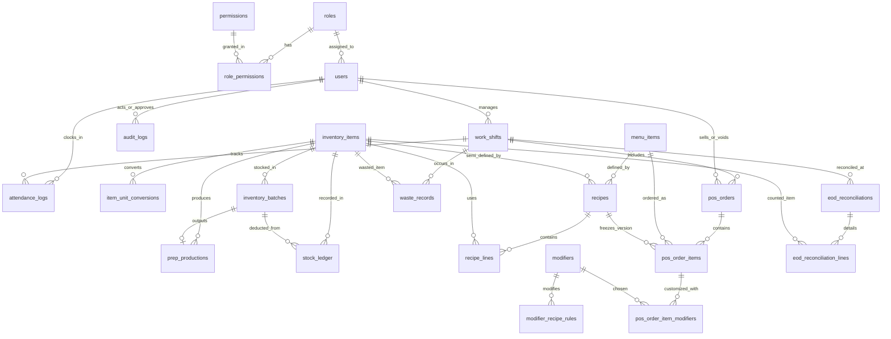

# ĐẶC TẢ KIẾN TRÚC PHẦN MỀM QUẢN LÝ VẬN HÀNH F&B CHỐNG THẤT THOÁT

> **Mục tiêu tài liệu:** Hồ sơ đặc tả toàn diện (Master Blueprint) sẵn sàng nạp trực tiếp vào **Antigravity** để AI Agent khởi tạo dự án Full-stack (PostgreSQL + Backend API + Frontend Web/POS) theo đúng nghiệp vụ thực chiến của ngành F&B.

---

## PHẦN 1: PHÂN TÍCH NỖI ĐAU THỰC TẾ & PHẠM VI SẢN PHẨM

Ba phân hệ cốt lõi **(Nguyên vật liệu – Con người – Công thức)** chỉ mới là phần đầu vào (Back-of-House). Để phần mềm chạy thực tế tại quán và chặn đứng thất thoát âm thầm, hệ thống phải khép kín vòng dữ liệu từ **Đơn bán ra (POS) → Công thức động (BOM) → Trừ kho theo hạn dùng (FEFO) → Báo hủy & Kiểm kho mù (EOD) → Trách nhiệm ca nhân sự → Lãi/Lỗ thực tế (COGS/P&L)**.

### 1.1. Nỗi đau thực tế trong 3 phân hệ cốt lõi

1. **Quản lý nguyên vật liệu (Kho):**
   * **Bẫy quy đổi đa đơn vị:** Mua vào tính theo thùng/can/kg (VD: 1 thùng = 12 hộp 1 lít), nhưng pha chế tính theo `ml`, `g`, `pump`.
   * **Kho bán thành phẩm (Sub-recipe / Prep):** Quầy bar không trừ từng gram lá trà khô khi bán lẻ, mà nấu thành mẻ lớn (nồi 2 kg trân châu, bình 5 lít cốt trà) có hạn dùng ngắn theo giờ.
   * **Quản lý lô & Hạn sử dụng (FEFO — First Expired, First Out):** Nguyên liệu tươi (sữa thanh trùng, cốt trà) hỏng theo giờ/ngày; cần cảnh báo cận date và chạm mức tồn tối thiểu (Min-stock).
2. **Quản lý công thức pha chế (BOM):**
   * **Biến thể động (Modifiers):** Khách tùy chỉnh Size L, 0%–50% đường, ít đá, đổi sữa hạt, thêm topping. Định lượng kho phải biến thiên động theo quy tắc `REPLACE → MULTIPLY → ADD`.
   * **Giá vốn (COGS) trượt theo giá nhập:** Tự động cập nhật giá vốn từng món theo giá lô thực tế và cảnh báo đỏ khi Food Cost vượt ngưỡng `30%–35%`.
   * **Kiêm tài liệu đào tạo (SOP):** Kèm ảnh thành phẩm, dụng cụ đong và thứ tự thao tác cho nhân viên mới.
3. **Quản lý con người (Nhân sự):**
   * **Xếp ca part-time xoay vòng:** Quản lý đăng ký ca trống, đổi ca có duyệt và kiểm soát tỷ lệ Quỹ lương / Doanh thu.
   * **Chấm công chống gian lận:** Xác thực đồng thời GPS + địa chỉ Wi-Fi nội bộ (BSSID) + ảnh chụp gương mặt.
   * **Phân quyền tách bạch nhiệm vụ (SoD):** Khóa chéo quyền giữa người cầm tiền, người pha chế và người kiểm kho.

### 1.2. Bốn mảnh ghép bắt buộc phải tích hợp

| Hạng mục / Module | Nỗi đau giải quyết | Giai đoạn |
|---|---|---|
| **Kho đa đơn vị + Bán thành phẩm + FEFO** | Chặn lệch tồn kho ảo và hỏng nguyên liệu tươi | Giai đoạn 1 (MVP) |
| **Công thức động (BOM) + Tính COGS theo lô** | Đồng bộ chất lượng ly và kiểm soát biên lợi nhuận | Giai đoạn 1 (MVP) |
| **POS mini hoặc API đồng bộ POS** | Tự động trừ kho theo đơn bán, xóa nhập liệu tay | Giai đoạn 1 (MVP) |
| **Báo hủy (Waste) + Đối soát kho mù cuối ngày (EOD)** | Tách bạch hao hụt tự nhiên với gian lận/pha ẩu | Giai đoạn 1 (MVP) |
| **Nhân sự (Ca trực, Chấm công, RBAC, Audit Log)** | Gắn trách nhiệm thất thoát theo đúng ca trực | Giai đoạn 1 (MVP) |
| **Đặt hàng NCC (PO) + Công nợ + Biến động giá** | Tối ưu dòng tiền nhập hàng và phát hiện NCC tăng giá | Giai đoạn 2 |
| **Checklist mở/đóng ca (SOP vận hành)** | Chuẩn hóa vệ sinh và bàn giao thiết bị khi chủ vắng mặt | Giai đoạn 2 |

---

## PHẦN 2: MA TRẬN PHÂN QUYỀN CHỐNG GIAN LẬN (RBAC & SoD)

### 2.1. Ba nguyên tắc Tách bạch nhiệm vụ (Separation of Duties)
* **Người cầm tiền** không được quyền tự hủy hóa đơn sau khi đã in tem/thu tiền.
* **Người pha chế** không được quyền sửa công thức (BOM) hay tự duyệt phiếu báo hủy.
* **Người kiểm kho / chốt két** phải thực hiện **Kiểm mù (Blind Count / Blind Close-out)** — hệ thống ẩn hoàn toàn số lý thuyết cho đến khi nhân viên bấm khóa nộp số đếm thực tế.

### 2.2. Ma trận phân quyền 4 vai trò

| Phân hệ / Nghiệp vụ | Chủ quán (`OWNER`) | Quản lý ca (`MANAGER`) | Thu ngân (`CASHIER`) | Barista (`BARISTA`) |
|---|:---:|:---:|:---:|:---:|
| **POS:** Tạo đơn, thu tiền, in tem | Toàn quyền | Thực thi | Thực thi | Khóa |
| **POS:** Giảm giá tay / Tặng món | Toàn quyền | Có hạn mức | Cần PIN duyệt | Khóa |
| **POS:** Hủy món **sau khi** in tem / thu tiền | Toàn quyền | Cần lý do (báo Chủ) | Cần PIN duyệt | Khóa |
| **POS:** Mở két không bán hàng (No-Sale) | Toàn quyền | Thực thi (ghi log) | Cần PIN duyệt | Khóa |
| **POS:** Chốt két tiền cuối ca | Xem đối soát | Duyệt (Kiểm mù) | Nhập tiền (Kiểm mù) | Khóa |
| **Kho:** Xem số lượng tồn & Cảnh báo FEFO | Toàn quyền | Xem (Ẩn giá) | Khóa | Xem (Ẩn giá) |
| **Kho:** Nhập/sửa đơn giá mua & Công nợ | Toàn quyền | Khóa | Khóa | Khóa |
| **Kho:** Nấu bán thành phẩm (Prep) | Toàn quyền | Thực thi | Khóa | Thực thi |
| **Kho:** Báo hủy hàng (Waste) | Toàn quyền | Duyệt (kèm ảnh) | Khóa | Tạo (chụp camera) |
| **Kho:** Kiểm kho cuối ngày (EOD) | Toàn quyền | Nhập số (Kiểm mù) | Khóa | Nhập số (Kiểm mù) |
| **Kho:** Xem độ lệch (Variance) & Cân bằng kho | Toàn quyền | Khóa | Khóa | Khóa |
| **BOM:** Xem định lượng & SOP pha chế | Toàn quyền | Xem (Ẩn giá) | Xem tên món | Xem (Ẩn giá) |
| **BOM:** Xem COGS & Sửa định lượng | Toàn quyền | Khóa | Khóa | Khóa |
| **Menu:** Bật/tắt trạng thái "Hết món" | Toàn quyền | Thực thi | Khóa | Đề xuất |
| **HR:** Chấm công GPS + Wi-Fi + Ảnh mặt | Xem tổng hợp | Tự chấm công | Tự chấm công | Tự chấm công |
| **HR:** Sửa tay giờ công | Toàn quyền | Đề xuất (Chủ duyệt) | Khóa | Khóa |
| **Audit:** Xem Nhật ký bất biến (`audit_logs`) | Chỉ xem | Khóa | Khóa | Khóa |

### 2.3. Năm thủ thuật gian lận thực chiến & Hàng rào chặn
1. **Bán xong hủy bill bỏ túi tiền mặt:** Chặn bằng mốc `ticket_printed_at` + bắt buộc **Manager Override PIN** + đẩy Push Notification tức thì về điện thoại Chủ quán.
2. **Chỉnh số kiểm kho cho khớp:** Chặn bằng **Kiểm kho mù** (`status = DRAFT_COUNTING` tuyệt đối không trả về tồn lý thuyết trên API).
3. **Thụt két lẻ cuối ca:** Chặn bằng **Chốt két mù** (đếm từng mệnh giá tiền trước, khóa ca xong hệ thống mới đối chiếu).
4. **Khai khống báo hủy để uống chùa:** Bắt buộc chụp ảnh trực tiếp từ camera (chặn tải từ thư viện) và có Quản lý bấm duyệt tại quầy mới trừ sổ cái.
5. **Nâng khống định lượng BOM để rút ruột nguyên liệu:** Chỉ duy nhất `OWNER` có quyền sửa BOM kèm lịch sử phiên bản (`version_no`).

### 2.4. Ba yêu cầu kỹ thuật bắt buộc
* **Cấm dùng chung tài khoản:** Mỗi nhân viên có tài khoản riêng và mã PIN 4–6 số riêng (`pos_pin_hash`).
* **Duyệt nhanh bằng PIN trong 3 giây:** Khi Thu ngân cần hủy món đã in tem, mở hộp thoại pop-up cho Quản lý nhập PIN phê duyệt mà không cần đăng xuất phiên làm việc.
* **Sổ cái & Nhật ký bất biến (Append-Only):** Khóa cứng `UPDATE`, `DELETE`, `TRUNCATE` ở cả tầng DB Role lẫn Trigger cho `stock_ledger` và `audit_logs`; dùng xóa mềm (`deleted_at`) cho các bảng danh mục.

---

## PHẦN 3: ĐỐI SOÁT KHO CHỦ ĐỘNG CUỐI NGÀY (EOD RECONCILIATION)

### 3.1. Công thức toán học chuẩn

$$\text{Tồn lý thuyết cuối ngày} = \text{Tồn đầu ngày} + \text{Nhập kho} - \text{Tiêu hao (POS} \times \text{BOM)} - \text{Hủy hàng hợp lệ} \pm \text{Bán thành phẩm}$$

$$\text{Chênh lệch (Variance)} = \text{Tồn thực tế kiểm đếm} - \text{Tồn lý thuyết cuối ngày}$$

$$\text{Tỷ lệ lệch (\%)} = \frac{|\text{Chênh lệch}|}{\text{Tổng lượng tiêu hao lý thuyết trong ngày}} \times 100\%$$

> **Lưu ý quan trọng:** Luôn chia độ lệch cho **Tổng lượng tiêu hao trong ngày**, tuyệt đối không chia cho Tổng tồn kho để tránh làm mờ tỷ lệ thất thoát thực tế.

### 3.2. Phân loại kiểm kho ABC & 2 mẹo vận hành thực chiến
* **Nhóm A (Bắt buộc kiểm mỗi tối trong 5 phút — 10 đến 15 mã):** Sữa tươi, cà phê hạt, kem béo, siro đắt tiền, cốt trà/trân châu nấu sẵn và **Ly nhựa / Nắp ly**.
* **Nhóm B (Kiểm 1 lần/tuần):** Bột matcha, cacao, mứt, đường nước.
* **Nhóm C (Kiểm 1 lần/tháng):** Ống hút, túi mang đi, khăn giấy.
* **Vũ khí "Đếm ly nhựa":** Ly nhựa là số nguyên tuyệt đối; mất từ 3 ly trở lên không có trong phiếu hủy là dấu hiệu rõ ràng của bán thu tiền mặt ngoài máy POS.
* **Mẹo "Cân cả chai" (Tare Weight):** Lưu trước `tare_weight_g` (trọng lượng vỏ chai rỗng). Cuối ca Barista chỉ cần đặt chai đang dùng dở lên cân nhập trọng lượng tổng (`weighed_gross_g`), máy tự tính:
  $$\text{Tồn thực tế} = (\text{Số hộp nguyên} \times \text{Hệ số quy đổi}) + \max(0, \text{Cân tổng} - \text{Trọng lượng vỏ rỗng})$$

### 3.3. Quy tắc Đèn giao thông & Cảnh báo lệch dương

| Mức độ | Ngưỡng lệch trên tiêu hao | Hành động tự động |
|---|---|---|
| **Xanh (`GREEN`)** | Dưới 2% | Tự động chấp nhận, lưu báo cáo ngày |
| **Vàng (`YELLOW`)** | Từ 2% đến 5% | Gom vào báo cáo sáng hôm sau; lặp 3 ngày liên tiếp tự nâng lên Đỏ |
| **Đỏ (`RED`)** | Trên 5% *(hoặc mất từ 3 ly nhựa trở lên)* | Bắn cảnh báo khẩn (App/Zalo/Telegram) kèm danh sách nhân sự ca trực và yêu cầu giải trình |

* **Cảnh báo lệch dương bất thường (dư trên 5%):** Bắt buộc cảnh báo vì thường do Barista pha ăn bớt định lượng (làm hỏng vị đồ uống) hoặc quản lý quên nhập phiếu mua hàng.

---

## PHẦN 4: KIẾN TRÚC CƠ SỞ DỮ LIỆU (23 BẢNG — POSTGRESQL 14+)

### 4.1. Bốn nguyên tắc thiết kế CSDL
1. **Quy chuẩn đơn vị gốc (`base_unit`):** Mọi giao dịch lưu xuống sổ cái theo `ml`, `g`, hoặc `pcs`.
2. **Gộp Nguyên liệu thô & Bán thành phẩm:** Dùng chung bảng `inventory_items` phân biệt qua `item_type` (`RAW`, `SEMI_FINISHED`, `PACKAGING`).
3. **Sổ cái bất biến (`stock_ledger`):** Chỉ `INSERT`, khóa `UPDATE/DELETE/TRUNCATE` để truy vết 100% tồn lý thuyết tại mọi thời điểm.
4. **Đóng băng lịch sử (`Snapshot`):** `pos_order_items` khóa cứng `recipe_version_id` và `cogs_snapshot` theo giá lô thực xuất.

### 4.2. Sơ đồ quan hệ tổng quan (Mermaid ERD)



---

## PHẦN 5: MÃ NGUỒN POSTGRESQL HOÀN CHỈNH (SẴN SÀNG THỰC THI)

### 5.1. Kịch bản DDL tạo 23 bảng, Ràng buộc, Chỉ mục & Khóa bảo mật (`01_schema.sql`)

```sql
-- ============================================================================
-- HỆ THỐNG QUẢN LÝ VẬN HÀNH F&B CHỐNG THẤT THOÁT (POSTGRESQL 14+)
-- File 01: Schema 23 bảng, Constraints, Indexes, Immutable Triggers & DB Role
-- ============================================================================

CREATE EXTENSION IF NOT EXISTS pgcrypto;

-- 1. roles
CREATE TABLE roles (
    id          UUID PRIMARY KEY DEFAULT gen_random_uuid(),
    code        VARCHAR(30)  NOT NULL UNIQUE,
    name        VARCHAR(100) NOT NULL,
    description TEXT,
    created_at  TIMESTAMPTZ  NOT NULL DEFAULT NOW(),
    CONSTRAINT chk_roles_code CHECK (code IN ('OWNER', 'MANAGER', 'CASHIER', 'BARISTA'))
);

-- 2. permissions
CREATE TABLE permissions (
    id                    UUID PRIMARY KEY DEFAULT gen_random_uuid(),
    code                  VARCHAR(80)  NOT NULL UNIQUE,
    module                VARCHAR(40)  NOT NULL,
    description           TEXT,
    requires_pin_override BOOLEAN      NOT NULL DEFAULT FALSE,
    created_at            TIMESTAMPTZ  NOT NULL DEFAULT NOW(),
    CONSTRAINT chk_permissions_module CHECK (
        module IN ('POS', 'INVENTORY', 'BOM', 'EOD', 'HR', 'AUDIT')
    )
);

-- 3. role_permissions
CREATE TABLE role_permissions (
    role_id          UUID  NOT NULL REFERENCES roles(id) ON DELETE CASCADE,
    permission_id    UUID  NOT NULL REFERENCES permissions(id) ON DELETE CASCADE,
    constraints_json JSONB NOT NULL DEFAULT '{}'::jsonb,
    PRIMARY KEY (role_id, permission_id)
);

-- 4. users
CREATE TABLE users (
    id            UUID PRIMARY KEY DEFAULT gen_random_uuid(),
    role_id       UUID           NOT NULL REFERENCES roles(id) ON DELETE RESTRICT,
    full_name     VARCHAR(120)   NOT NULL,
    phone         VARCHAR(20)    NOT NULL UNIQUE,
    password_hash VARCHAR(255)   NOT NULL,
    pos_pin_hash  VARCHAR(255),
    hourly_rate   NUMERIC(12, 2) NOT NULL DEFAULT 0,
    is_active     BOOLEAN        NOT NULL DEFAULT TRUE,
    created_at    TIMESTAMPTZ    NOT NULL DEFAULT NOW(),
    deleted_at    TIMESTAMPTZ,
    CONSTRAINT chk_users_hourly_rate CHECK (hourly_rate >= 0)
);

-- 5. work_shifts
CREATE TABLE work_shifts (
    id                 UUID PRIMARY KEY DEFAULT gen_random_uuid(),
    shift_date         DATE           NOT NULL,
    shift_slot         VARCHAR(20)    NOT NULL,
    manager_id         UUID           NOT NULL REFERENCES users(id) ON DELETE RESTRICT,
    opened_at          TIMESTAMPTZ    NOT NULL DEFAULT NOW(),
    closed_at          TIMESTAMPTZ,
    opening_cash       NUMERIC(15, 2) NOT NULL DEFAULT 0,
    blind_cash_counted NUMERIC(15, 2),
    expected_cash_pos  NUMERIC(15, 2),
    cash_variance      NUMERIC(15, 2),
    status             VARCHAR(20)    NOT NULL DEFAULT 'OPEN',
    CONSTRAINT chk_work_shifts_slot   CHECK (shift_slot IN ('MORNING', 'AFTERNOON', 'EVENING', 'FULL_DAY')),
    CONSTRAINT chk_work_shifts_status CHECK (status IN ('OPEN', 'CLOSED', 'LOCKED')),
    CONSTRAINT chk_work_shifts_cash   CHECK (opening_cash >= 0 AND (blind_cash_counted IS NULL OR blind_cash_counted >= 0)),
    CONSTRAINT chk_work_shifts_time   CHECK (closed_at IS NULL OR closed_at >= opened_at)
);

-- 6. attendance_logs
CREATE TABLE attendance_logs (
    id               UUID PRIMARY KEY DEFAULT gen_random_uuid(),
    user_id          UUID          NOT NULL REFERENCES users(id) ON DELETE RESTRICT,
    shift_id         UUID          NOT NULL REFERENCES work_shifts(id) ON DELETE RESTRICT,
    clock_in_at      TIMESTAMPTZ   NOT NULL,
    clock_out_at     TIMESTAMPTZ,
    wifi_bssid       VARCHAR(32)   NOT NULL,
    gps_lat          NUMERIC(9, 6) NOT NULL,
    gps_lng          NUMERIC(9, 6) NOT NULL,
    face_photo_url   TEXT          NOT NULL,
    is_manual_edited BOOLEAN       NOT NULL DEFAULT FALSE,
    edit_approved_by UUID          REFERENCES users(id) ON DELETE RESTRICT,
    edit_reason      TEXT,
    CONSTRAINT chk_attendance_time CHECK (clock_out_at IS NULL OR clock_out_at >= clock_in_at),
    CONSTRAINT chk_attendance_manual_edit CHECK (
        is_manual_edited = FALSE OR (edit_approved_by IS NOT NULL AND edit_reason IS NOT NULL)
    )
);

-- 7. inventory_items
CREATE TABLE inventory_items (
    id             UUID PRIMARY KEY DEFAULT gen_random_uuid(),
    sku            VARCHAR(50)    NOT NULL UNIQUE,
    name           VARCHAR(150)   NOT NULL,
    item_type      VARCHAR(20)    NOT NULL,
    abc_class      CHAR(1)        NOT NULL DEFAULT 'B',
    base_unit      VARCHAR(15)    NOT NULL,
    tare_weight_g  NUMERIC(10, 3) NOT NULL DEFAULT 0,
    min_stock_base NUMERIC(12, 3) NOT NULL DEFAULT 0,
    avg_unit_cost  NUMERIC(15, 4) NOT NULL DEFAULT 0,
    is_active      BOOLEAN        NOT NULL DEFAULT TRUE,
    created_at     TIMESTAMPTZ    NOT NULL DEFAULT NOW(),
    deleted_at     TIMESTAMPTZ,
    CONSTRAINT chk_items_type     CHECK (item_type IN ('RAW', 'SEMI_FINISHED', 'PACKAGING')),
    CONSTRAINT chk_items_abc      CHECK (abc_class IN ('A', 'B', 'C')),
    CONSTRAINT chk_items_baseunit CHECK (base_unit IN ('ml', 'g', 'pcs')),
    CONSTRAINT chk_items_nonneg   CHECK (tare_weight_g >= 0 AND min_stock_base >= 0 AND avg_unit_cost >= 0)
);

-- 8. item_unit_conversions
CREATE TABLE item_unit_conversions (
    id               UUID PRIMARY KEY DEFAULT gen_random_uuid(),
    item_id          UUID           NOT NULL REFERENCES inventory_items(id) ON DELETE RESTRICT,
    unit_name        VARCHAR(40)    NOT NULL,
    to_base_factor   NUMERIC(12, 3) NOT NULL,
    is_purchase_unit BOOLEAN        NOT NULL DEFAULT FALSE,
    is_count_unit    BOOLEAN        NOT NULL DEFAULT FALSE,
    CONSTRAINT uq_item_unit_name     UNIQUE (item_id, unit_name),
    CONSTRAINT chk_conversion_factor CHECK (to_base_factor > 0)
);

-- 9. inventory_batches
CREATE TABLE inventory_batches (
    id                 UUID PRIMARY KEY DEFAULT gen_random_uuid(),
    item_id            UUID           NOT NULL REFERENCES inventory_items(id) ON DELETE RESTRICT,
    batch_code         VARCHAR(60)    NOT NULL,
    received_at        TIMESTAMPTZ    NOT NULL DEFAULT NOW(),
    expires_at         TIMESTAMPTZ    NOT NULL,
    initial_qty_base   NUMERIC(12, 3) NOT NULL,
    remaining_qty_base NUMERIC(12, 3) NOT NULL,
    unit_cost          NUMERIC(15, 4) NOT NULL,
    CONSTRAINT uq_item_batch_code CHECK (LENGTH(TRIM(batch_code)) > 0),
    CONSTRAINT chk_batch_dates    CHECK (expires_at > received_at),
    CONSTRAINT chk_batch_qty      CHECK (initial_qty_base > 0 AND remaining_qty_base >= 0 AND unit_cost >= 0)
);

-- 10. prep_productions
CREATE TABLE prep_productions (
    id              UUID PRIMARY KEY DEFAULT gen_random_uuid(),
    semi_item_id    UUID           NOT NULL REFERENCES inventory_items(id) ON DELETE RESTRICT,
    output_batch_id UUID           NOT NULL UNIQUE REFERENCES inventory_batches(id) ON DELETE RESTRICT,
    prepared_by     UUID           NOT NULL REFERENCES users(id) ON DELETE RESTRICT,
    yield_qty_base  NUMERIC(12, 3) NOT NULL,
    prepared_at     TIMESTAMPTZ    NOT NULL DEFAULT NOW(),
    expires_at      TIMESTAMPTZ    NOT NULL,
    notes           TEXT,
    CONSTRAINT chk_prep_yield CHECK (yield_qty_base > 0),
    CONSTRAINT chk_prep_dates CHECK (expires_at > prepared_at)
);

-- 11. stock_ledger (APPEND-ONLY)
CREATE TABLE stock_ledger (
    id                 UUID PRIMARY KEY DEFAULT gen_random_uuid(),
    item_id            UUID           NOT NULL REFERENCES inventory_items(id) ON DELETE RESTRICT,
    batch_id           UUID           REFERENCES inventory_batches(id) ON DELETE RESTRICT,
    txn_type           VARCHAR(20)    NOT NULL,
    qty_change_base    NUMERIC(12, 3) NOT NULL,
    unit_cost_snapshot NUMERIC(15, 4) NOT NULL,
    ref_table          VARCHAR(50)    NOT NULL,
    ref_id             UUID           NOT NULL,
    created_by         UUID           NOT NULL REFERENCES users(id) ON DELETE RESTRICT,
    created_at         TIMESTAMPTZ    NOT NULL DEFAULT NOW(),
    CONSTRAINT chk_ledger_txn_type CHECK (
        txn_type IN ('PURCHASE', 'POS_SALE', 'PREP_OUT', 'PREP_IN', 'WASTE', 'EOD_ADJ')
    ),
    CONSTRAINT chk_ledger_nonzero  CHECK (qty_change_base <> 0),
    CONSTRAINT chk_ledger_cost     CHECK (unit_cost_snapshot >= 0)
);

-- 12. menu_items
CREATE TABLE menu_items (
    id           UUID PRIMARY KEY DEFAULT gen_random_uuid(),
    code         VARCHAR(40)    NOT NULL UNIQUE,
    name         VARCHAR(150)   NOT NULL,
    category     VARCHAR(80)    NOT NULL,
    base_price   NUMERIC(15, 2) NOT NULL,
    is_available BOOLEAN        NOT NULL DEFAULT TRUE,
    created_at   TIMESTAMPTZ    NOT NULL DEFAULT NOW(),
    deleted_at   TIMESTAMPTZ,
    CONSTRAINT chk_menu_price CHECK (base_price >= 0)
);

-- 13. recipes
CREATE TABLE recipes (
    id                  UUID PRIMARY KEY DEFAULT gen_random_uuid(),
    menu_item_id        UUID           REFERENCES menu_items(id) ON DELETE RESTRICT,
    semi_item_id        UUID           REFERENCES inventory_items(id) ON DELETE RESTRICT,
    version_no          INTEGER        NOT NULL DEFAULT 1,
    is_active           BOOLEAN        NOT NULL DEFAULT TRUE,
    standard_yield_base NUMERIC(12, 3) NOT NULL DEFAULT 1,
    calculated_cogs     NUMERIC(15, 2) NOT NULL DEFAULT 0,
    sop_steps_json      JSONB          NOT NULL DEFAULT '[]'::jsonb,
    image_url           TEXT,
    effective_from      TIMESTAMPTZ    NOT NULL DEFAULT NOW(),
    created_by          UUID           NOT NULL REFERENCES users(id) ON DELETE RESTRICT,
    CONSTRAINT chk_recipes_target_xor CHECK ((menu_item_id IS NOT NULL) <> (semi_item_id IS NOT NULL)),
    CONSTRAINT chk_recipes_version    CHECK (version_no > 0),
    CONSTRAINT chk_recipes_yield      CHECK (standard_yield_base > 0),
    CONSTRAINT chk_recipes_cogs       CHECK (calculated_cogs >= 0)
);

-- 14. recipe_lines
CREATE TABLE recipe_lines (
    id              UUID PRIMARY KEY DEFAULT gen_random_uuid(),
    recipe_id       UUID           NOT NULL REFERENCES recipes(id) ON DELETE CASCADE,
    item_id         UUID           NOT NULL REFERENCES inventory_items(id) ON DELETE RESTRICT,
    qty_base        NUMERIC(12, 3) NOT NULL,
    ingredient_role VARCHAR(30)    NOT NULL,
    CONSTRAINT uq_recipe_item_role UNIQUE (recipe_id, item_id, ingredient_role),
    CONSTRAINT chk_recipe_line_qty CHECK (qty_base > 0),
    CONSTRAINT chk_ingredient_role CHECK (
        ingredient_role IN ('BASE_TEA', 'COFFEE', 'MILK', 'SUGAR', 'ICE', 'SYRUP', 'CUP', 'LID', 'TOPPING', 'OTHER')
    )
);

-- 15. modifiers
CREATE TABLE modifiers (
    id          UUID PRIMARY KEY DEFAULT gen_random_uuid(),
    group_name  VARCHAR(50)    NOT NULL,
    name        VARCHAR(100)   NOT NULL,
    price_delta NUMERIC(15, 2) NOT NULL DEFAULT 0,
    is_active   BOOLEAN        NOT NULL DEFAULT TRUE,
    CONSTRAINT uq_modifier_group_name UNIQUE (group_name, name)
);

-- 16. modifier_recipe_rules
CREATE TABLE modifier_recipe_rules (
    id                     UUID PRIMARY KEY DEFAULT gen_random_uuid(),
    modifier_id            UUID           NOT NULL REFERENCES modifiers(id) ON DELETE CASCADE,
    target_ingredient_role VARCHAR(30),
    target_item_id         UUID           REFERENCES inventory_items(id) ON DELETE RESTRICT,
    action_type            VARCHAR(20)    NOT NULL,
    value_num              NUMERIC(12, 3),
    replace_with_item_id   UUID           REFERENCES inventory_items(id) ON DELETE RESTRICT,
    CONSTRAINT chk_mod_action CHECK (action_type IN ('ADD', 'MULTIPLY', 'REPLACE')),
    CONSTRAINT chk_mod_target CHECK (
        (action_type = 'ADD' AND target_item_id IS NOT NULL AND value_num > 0) OR
        (action_type = 'MULTIPLY' AND (target_ingredient_role IS NOT NULL OR target_item_id IS NOT NULL) AND value_num >= 0) OR
        (action_type = 'REPLACE' AND (target_ingredient_role IS NOT NULL OR target_item_id IS NOT NULL) AND replace_with_item_id IS NOT NULL)
    )
);

-- 17. pos_orders
CREATE TABLE pos_orders (
    id               UUID PRIMARY KEY DEFAULT gen_random_uuid(),
    order_code       VARCHAR(40)    NOT NULL UNIQUE,
    shift_id         UUID           NOT NULL REFERENCES work_shifts(id) ON DELETE RESTRICT,
    cashier_id       UUID           NOT NULL REFERENCES users(id) ON DELETE RESTRICT,
    status           VARCHAR(20)    NOT NULL DEFAULT 'OPEN',
    subtotal         NUMERIC(15, 2) NOT NULL DEFAULT 0,
    discount_amount  NUMERIC(15, 2) NOT NULL DEFAULT 0,
    total_amount     NUMERIC(15, 2) NOT NULL DEFAULT 0,
    payment_method   VARCHAR(20)    NOT NULL DEFAULT 'CASH',
    void_approved_by UUID           REFERENCES users(id) ON DELETE RESTRICT,
    void_reason      TEXT,
    created_at       TIMESTAMPTZ    NOT NULL DEFAULT NOW(),
    paid_at          TIMESTAMPTZ,
    CONSTRAINT chk_orders_status  CHECK (status IN ('OPEN', 'PAID', 'VOIDED', 'REFUNDED')),
    CONSTRAINT chk_orders_payment CHECK (payment_method IN ('CASH', 'QR_TRANSFER', 'CARD', 'EWALLET')),
    CONSTRAINT chk_orders_amounts CHECK (subtotal >= 0 AND discount_amount >= 0 AND total_amount >= 0),
    CONSTRAINT chk_orders_void    CHECK (
        status NOT IN ('VOIDED', 'REFUNDED') OR (void_reason IS NOT NULL AND LENGTH(TRIM(void_reason)) > 0)
    )
);

-- 18. pos_order_items
CREATE TABLE pos_order_items (
    id                UUID PRIMARY KEY DEFAULT gen_random_uuid(),
    order_id          UUID           NOT NULL REFERENCES pos_orders(id) ON DELETE RESTRICT,
    menu_item_id      UUID           NOT NULL REFERENCES menu_items(id) ON DELETE RESTRICT,
    recipe_version_id UUID           NOT NULL REFERENCES recipes(id) ON DELETE RESTRICT,
    quantity          INTEGER        NOT NULL DEFAULT 1,
    unit_price        NUMERIC(15, 2) NOT NULL,
    cogs_snapshot     NUMERIC(15, 2) NOT NULL,
    ticket_printed_at TIMESTAMPTZ,
    CONSTRAINT chk_order_items_qty    CHECK (quantity > 0),
    CONSTRAINT chk_order_items_prices CHECK (unit_price >= 0 AND cogs_snapshot >= 0)
);

-- 19. pos_order_item_modifiers
CREATE TABLE pos_order_item_modifiers (
    id                   UUID PRIMARY KEY DEFAULT gen_random_uuid(),
    order_item_id        UUID           NOT NULL REFERENCES pos_order_items(id) ON DELETE RESTRICT,
    modifier_id          UUID           NOT NULL REFERENCES modifiers(id) ON DELETE RESTRICT,
    price_delta_snapshot NUMERIC(15, 2) NOT NULL DEFAULT 0
);

-- 20. waste_records
CREATE TABLE waste_records (
    id               UUID PRIMARY KEY DEFAULT gen_random_uuid(),
    shift_id         UUID           NOT NULL REFERENCES work_shifts(id) ON DELETE RESTRICT,
    item_id          UUID           NOT NULL REFERENCES inventory_items(id) ON DELETE RESTRICT,
    batch_id         UUID           REFERENCES inventory_batches(id) ON DELETE RESTRICT,
    qty_base         NUMERIC(12, 3) NOT NULL,
    reason_code      VARCHAR(30)    NOT NULL,
    notes            TEXT,
    camera_photo_url TEXT           NOT NULL,
    reported_by      UUID           NOT NULL REFERENCES users(id) ON DELETE RESTRICT,
    approved_by      UUID           REFERENCES users(id) ON DELETE RESTRICT,
    status           VARCHAR(20)    NOT NULL DEFAULT 'PENDING',
    created_at       TIMESTAMPTZ    NOT NULL DEFAULT NOW(),
    approved_at      TIMESTAMPTZ,
    CONSTRAINT chk_waste_qty    CHECK (qty_base > 0),
    CONSTRAINT chk_waste_photo  CHECK (LENGTH(TRIM(camera_photo_url)) > 0),
    CONSTRAINT chk_waste_reason CHECK (reason_code IN ('SPILL', 'EXPIRED', 'WRONG_DRINK', 'QUALITY_TEST', 'EQUIPMENT_FAULT')),
    CONSTRAINT chk_waste_status CHECK (status IN ('PENDING', 'APPROVED', 'REJECTED')),
    CONSTRAINT chk_waste_approve CHECK (
        status <> 'APPROVED' OR (approved_by IS NOT NULL AND approved_at IS NOT NULL)
    )
);

-- 21. eod_reconciliations
CREATE TABLE eod_reconciliations (
    id                 UUID PRIMARY KEY DEFAULT gen_random_uuid(),
    business_date      DATE           NOT NULL,
    shift_id           UUID           NOT NULL REFERENCES work_shifts(id) ON DELETE RESTRICT,
    abc_scope          VARCHAR(10)    NOT NULL DEFAULT 'A',
    status             VARCHAR(20)    NOT NULL DEFAULT 'DRAFT_COUNTING',
    counted_by         UUID           NOT NULL REFERENCES users(id) ON DELETE RESTRICT,
    locked_by          UUID           REFERENCES users(id) ON DELETE RESTRICT,
    total_variance_vnd NUMERIC(15, 2) NOT NULL DEFAULT 0,
    submitted_at       TIMESTAMPTZ,
    alert_sent_at      TIMESTAMPTZ,
    created_at         TIMESTAMPTZ    NOT NULL DEFAULT NOW(),
    CONSTRAINT uq_eod_date_shift UNIQUE (business_date, shift_id),
    CONSTRAINT chk_eod_scope     CHECK (abc_scope IN ('A', 'AB', 'ALL')),
    CONSTRAINT chk_eod_status    CHECK (status IN ('DRAFT_COUNTING', 'SUBMITTED', 'LOCKED'))
);

-- 22. eod_reconciliation_lines
CREATE TABLE eod_reconciliation_lines (
    id                   UUID PRIMARY KEY DEFAULT gen_random_uuid(),
    reconciliation_id    UUID           NOT NULL REFERENCES eod_reconciliations(id) ON DELETE CASCADE,
    item_id              UUID           NOT NULL REFERENCES inventory_items(id) ON DELETE RESTRICT,
    counted_sealed_units NUMERIC(12, 3) NOT NULL DEFAULT 0,
    weighed_gross_g      NUMERIC(12, 3) NOT NULL DEFAULT 0,
    counted_qty_base     NUMERIC(12, 3) NOT NULL DEFAULT 0,
    opening_qty_base     NUMERIC(12, 3),
    purchased_qty_base   NUMERIC(12, 3),
    pos_usage_qty_base   NUMERIC(12, 3),
    waste_qty_base       NUMERIC(12, 3),
    theoretical_qty_base NUMERIC(12, 3),
    variance_qty_base    NUMERIC(12, 3),
    variance_pct_usage   NUMERIC(8, 2),
    variance_vnd         NUMERIC(15, 2),
    alert_level          VARCHAR(10),
    explanation_note     TEXT,
    CONSTRAINT uq_eod_line_item UNIQUE (reconciliation_id, item_id),
    CONSTRAINT chk_eod_counts   CHECK (counted_sealed_units >= 0 AND weighed_gross_g >= 0 AND counted_qty_base >= 0),
    CONSTRAINT chk_eod_alert    CHECK (alert_level IS NULL OR alert_level IN ('GREEN', 'YELLOW', 'RED'))
);

-- 23. audit_logs (APPEND-ONLY)
CREATE TABLE audit_logs (
    id              UUID PRIMARY KEY DEFAULT gen_random_uuid(),
    actor_id        UUID         NOT NULL REFERENCES users(id) ON DELETE RESTRICT,
    approver_id     UUID         REFERENCES users(id) ON DELETE RESTRICT,
    action_code     VARCHAR(60)  NOT NULL,
    entity_table    VARCHAR(60)  NOT NULL,
    entity_id       UUID         NOT NULL,
    old_values_json JSONB,
    new_values_json JSONB,
    reason          TEXT,
    device_ip       INET,
    created_at      TIMESTAMPTZ  NOT NULL DEFAULT NOW()
);

-- INDEXES
CREATE INDEX idx_batches_fefo            ON inventory_batches (item_id, expires_at ASC) WHERE remaining_qty_base > 0;
CREATE INDEX idx_stock_ledger_item_time  ON stock_ledger (item_id, created_at DESC);
CREATE INDEX idx_stock_ledger_ref        ON stock_ledger (ref_table, ref_id);
CREATE UNIQUE INDEX uq_recipes_active_menu ON recipes (menu_item_id) WHERE is_active = TRUE AND menu_item_id IS NOT NULL;
CREATE UNIQUE INDEX uq_recipes_active_semi ON recipes (semi_item_id) WHERE is_active = TRUE AND semi_item_id IS NOT NULL;
CREATE INDEX idx_pos_orders_shift_status ON pos_orders (shift_id, status, created_at DESC);
CREATE INDEX idx_pos_order_items_order   ON pos_order_items (order_id);
CREATE INDEX idx_waste_shift_status      ON waste_records (shift_id, status, created_at DESC);
CREATE INDEX idx_eod_lines_alerts        ON eod_reconciliation_lines (alert_level, reconciliation_id) WHERE alert_level IN ('YELLOW', 'RED');
CREATE INDEX idx_audit_logs_entity       ON audit_logs (entity_table, entity_id, created_at DESC);
CREATE INDEX idx_audit_logs_actor_time   ON audit_logs (actor_id, created_at DESC);
CREATE INDEX idx_attendance_shift_user   ON attendance_logs (shift_id, user_id);

-- IMMUTABILITY TRIGGERS & ROLE
CREATE OR REPLACE FUNCTION fn_prevent_immutable_mutation()
RETURNS TRIGGER AS $$
BEGIN
    RAISE EXCEPTION 'VI PHẠM BẢO MẬT: Bảng "%" là sổ cái bất biến (Append-Only). Cấm %!',
        TG_TABLE_NAME, TG_OP USING ERRCODE = '42501';
END;
$$ LANGUAGE plpgsql;

CREATE TRIGGER trg_stock_ledger_immutable
    BEFORE UPDATE OR DELETE OR TRUNCATE ON stock_ledger
    FOR EACH STATEMENT EXECUTE FUNCTION fn_prevent_immutable_mutation();

CREATE TRIGGER trg_audit_logs_immutable
    BEFORE UPDATE OR DELETE OR TRUNCATE ON audit_logs
    FOR EACH STATEMENT EXECUTE FUNCTION fn_prevent_immutable_mutation();

DO $$
BEGIN
    IF NOT EXISTS (SELECT 1 FROM pg_roles WHERE rolname = 'fnb_app_user') THEN
        CREATE ROLE fnb_app_user LOGIN PASSWORD 'CHANGE_THIS_STRONG_PASSWORD';
    END IF;
END $$;

GRANT USAGE ON SCHEMA public TO fnb_app_user;
GRANT SELECT, INSERT, UPDATE ON ALL TABLES IN SCHEMA public TO fnb_app_user;
REVOKE UPDATE, DELETE, TRUNCATE ON TABLE stock_ledger, audit_logs FROM fnb_app_user, PUBLIC;
GRANT SELECT, INSERT ON TABLE stock_ledger, audit_logs TO fnb_app_user;
```

### 5.2. Bộ 3 hàm PL/pgSQL xử lý BOM động & Trừ kho FEFO (`02_functions_fefo.sql`)

```sql
-- ============================================================================
-- File 02: Bộ 3 hàm PL/pgSQL tính BOM động (REPLACE -> MULTIPLY -> ADD) & FEFO
-- ============================================================================

CREATE OR REPLACE FUNCTION fn_calculate_dynamic_bom(p_order_item_id UUID)
RETURNS TABLE (item_id UUID, total_qty_base NUMERIC(12, 3))
LANGUAGE sql STABLE AS $$
WITH order_ctx AS (
    SELECT id, recipe_version_id, quantity FROM pos_order_items WHERE id = p_order_item_id
),
applied_rules AS (
    SELECT mrr.id, mrr.action_type, mrr.target_ingredient_role, mrr.target_item_id, mrr.value_num, mrr.replace_with_item_id
    FROM pos_order_item_modifiers oim
    JOIN modifier_recipe_rules mrr ON mrr.modifier_id = oim.modifier_id
    WHERE oim.order_item_id = p_order_item_id
),
base_after_replace AS (
    SELECT
        rl.id AS recipe_line_id,
        COALESCE(rep.replace_with_item_id, rl.item_id) AS effective_item_id,
        rl.item_id AS original_item_id,
        rl.ingredient_role, rl.qty_base, oc.quantity AS cup_qty
    FROM order_ctx oc
    JOIN recipe_lines rl ON rl.recipe_id = oc.recipe_version_id
    LEFT JOIN LATERAL (
        SELECT ar.replace_with_item_id
        FROM applied_rules ar
        WHERE ar.action_type = 'REPLACE'
          AND ((ar.target_item_id IS NOT NULL AND ar.target_item_id = rl.item_id)
               OR (ar.target_item_id IS NULL AND ar.target_ingredient_role = rl.ingredient_role))
        ORDER BY (ar.target_item_id IS NOT NULL) DESC, ar.id ASC
        LIMIT 1
    ) rep ON TRUE
),
base_after_multiply AS (
    SELECT
        b.effective_item_id AS item_id,
        ROUND(b.qty_base * COALESCE(mul.net_factor, 1.0) * b.cup_qty, 3) AS line_qty_base
    FROM base_after_replace b
    LEFT JOIN LATERAL (
        SELECT CASE
            WHEN BOOL_OR(ar.value_num = 0) THEN 0::NUMERIC
            ELSE EXP(SUM(LN(NULLIF(ar.value_num, 0))))::NUMERIC
        END AS net_factor
        FROM applied_rules ar
        WHERE ar.action_type = 'MULTIPLY'
          AND ((ar.target_item_id IS NOT NULL AND ar.target_item_id IN (b.original_item_id, b.effective_item_id))
               OR (ar.target_item_id IS NULL AND ar.target_ingredient_role = b.ingredient_role))
    ) mul ON TRUE
),
added_lines AS (
    SELECT ar.target_item_id AS item_id, ROUND(ar.value_num * oc.quantity, 3) AS line_qty_base
    FROM order_ctx oc
    JOIN applied_rules ar ON ar.action_type = 'ADD'
),
combined AS (
    SELECT item_id, line_qty_base FROM base_after_multiply
    UNION ALL
    SELECT item_id, line_qty_base FROM added_lines
)
SELECT c.item_id, SUM(c.line_qty_base)::NUMERIC(12, 3) AS total_qty_base
FROM combined c
GROUP BY c.item_id
HAVING SUM(c.line_qty_base) > 0
ORDER BY c.item_id ASC;
$$;

CREATE OR REPLACE FUNCTION fn_deduct_stock_fefo(
    p_item_id UUID, p_qty_needed NUMERIC(12, 3), p_txn_type VARCHAR(20),
    p_ref_table VARCHAR(50), p_ref_id UUID, p_actor_id UUID, p_allow_negative BOOLEAN DEFAULT TRUE
)
RETURNS TABLE (total_cogs NUMERIC(15, 2), shortfall_qty NUMERIC(12, 3))
LANGUAGE plpgsql AS $$
DECLARE
    v_item      RECORD;
    v_batch     RECORD;
    v_remaining NUMERIC(12, 3) := p_qty_needed;
    v_deduct    NUMERIC(12, 3);
    v_cogs_acc  NUMERIC(18, 4) := 0;
    v_shortfall NUMERIC(12, 3) := 0;
BEGIN
    IF p_qty_needed IS NULL OR p_qty_needed <= 0 THEN
        RAISE EXCEPTION 'Số lượng cần trừ phải lớn hơn 0 (item_id: %)', p_item_id USING ERRCODE = '22023';
    END IF;

    SELECT id, sku, name, avg_unit_cost INTO v_item
    FROM inventory_items WHERE id = p_item_id AND deleted_at IS NULL FOR UPDATE;
    IF NOT FOUND THEN
        RAISE EXCEPTION 'Không tìm thấy nguyên liệu id: %', p_item_id USING ERRCODE = 'P0002';
    END IF;

    FOR v_batch IN
        SELECT id, remaining_qty_base, unit_cost
        FROM inventory_batches
        WHERE item_id = p_item_id AND remaining_qty_base > 0 AND expires_at > NOW()
        ORDER BY expires_at ASC, received_at ASC, id ASC
        FOR UPDATE
    LOOP
        v_deduct := LEAST(v_remaining, v_batch.remaining_qty_base);
        UPDATE inventory_batches SET remaining_qty_base = remaining_qty_base - v_deduct WHERE id = v_batch.id;
        INSERT INTO stock_ledger (item_id, batch_id, txn_type, qty_change_base, unit_cost_snapshot, ref_table, ref_id, created_by)
        VALUES (p_item_id, v_batch.id, p_txn_type, -v_deduct, v_batch.unit_cost, p_ref_table, p_ref_id, p_actor_id);

        v_cogs_acc  := v_cogs_acc + (v_deduct * v_batch.unit_cost);
        v_remaining := v_remaining - v_deduct;
        EXIT WHEN v_remaining <= 0;
    END LOOP;

    IF v_remaining > 0 THEN
        IF NOT p_allow_negative THEN
            RAISE EXCEPTION 'Không đủ tồn kho còn hạn cho "%" (SKU: %). Thiếu: %', v_item.name, v_item.sku, v_remaining USING ERRCODE = 'P0001';
        END IF;
        INSERT INTO stock_ledger (item_id, batch_id, txn_type, qty_change_base, unit_cost_snapshot, ref_table, ref_id, created_by)
        VALUES (p_item_id, NULL, p_txn_type, -v_remaining, v_item.avg_unit_cost, p_ref_table, p_ref_id, p_actor_id);
        v_cogs_acc  := v_cogs_acc + (v_remaining * v_item.avg_unit_cost);
        v_shortfall := v_remaining;
    END IF;

    RETURN QUERY SELECT ROUND(v_cogs_acc, 2), v_shortfall;
END;
$$;

CREATE OR REPLACE FUNCTION fn_process_pos_order_deduction(
    p_order_id UUID, p_actor_id UUID, p_allow_negative BOOLEAN DEFAULT TRUE
)
RETURNS JSONB LANGUAGE plpgsql AS $$
DECLARE
    v_order            RECORD;
    v_oi               RECORD;
    v_bom_line         RECORD;
    v_deduct_res       RECORD;
    v_line_cogs_total  NUMERIC(15, 2);
    v_order_cogs_total NUMERIC(15, 2) := 0;
    v_negative_alerts  JSONB := '[]'::jsonb;
    v_low_stock_alerts JSONB := '[]'::jsonb;
BEGIN
    SELECT id, order_code, status INTO v_order FROM pos_orders WHERE id = p_order_id FOR UPDATE;
    IF NOT FOUND THEN RAISE EXCEPTION 'Không tìm thấy hóa đơn id: %', p_order_id USING ERRCODE = 'P0002'; END IF;
    IF v_order.status IN ('VOIDED', 'REFUNDED') THEN
        RAISE EXCEPTION 'Không thể trừ kho cho hóa đơn "%" trạng thái %', v_order.order_code, v_order.status USING ERRCODE = 'P0003';
    END IF;
    IF EXISTS (
        SELECT 1 FROM stock_ledger sl JOIN pos_order_items oi ON oi.id = sl.ref_id
        WHERE sl.ref_table = 'pos_order_items' AND sl.txn_type = 'POS_SALE' AND oi.order_id = p_order_id
    ) THEN
        RAISE EXCEPTION 'Hóa đơn "%" đã được trừ kho trước đó.', v_order.order_code USING ERRCODE = 'P0004';
    END IF;

    CREATE TEMP TABLE IF NOT EXISTS tmp_order_bom (
        order_item_id UUID NOT NULL, item_id UUID NOT NULL, qty_base NUMERIC(12, 3) NOT NULL
    ) ON COMMIT DROP;
    TRUNCATE tmp_order_bom;

    INSERT INTO tmp_order_bom (order_item_id, item_id, qty_base)
    SELECT oi.id, bom.item_id, bom.total_qty_base
    FROM pos_order_items oi CROSS JOIN LATERAL fn_calculate_dynamic_bom(oi.id) bom
    WHERE oi.order_id = p_order_id;

    PERFORM 1 FROM inventory_items WHERE id IN (SELECT DISTINCT item_id FROM tmp_order_bom) ORDER BY id ASC FOR UPDATE;

    FOR v_oi IN SELECT id, quantity FROM pos_order_items WHERE order_id = p_order_id ORDER BY id ASC LOOP
        v_line_cogs_total := 0;
        FOR v_bom_line IN SELECT item_id, qty_base FROM tmp_order_bom WHERE order_item_id = v_oi.id ORDER BY item_id ASC LOOP
            SELECT total_cogs, shortfall_qty INTO v_deduct_res
            FROM fn_deduct_stock_fefo(v_bom_line.item_id, v_bom_line.qty_base, 'POS_SALE', 'pos_order_items', v_oi.id, p_actor_id, p_allow_negative);
            v_line_cogs_total := v_line_cogs_total + v_deduct_res.total_cogs;
            IF v_deduct_res.shortfall_qty > 0 THEN
                v_negative_alerts := v_negative_alerts || jsonb_build_object('order_item_id', v_oi.id, 'item_id', v_bom_line.item_id, 'shortfall_qty', v_deduct_res.shortfall_qty);
            END IF;
        END LOOP;
        UPDATE pos_order_items
        SET cogs_snapshot = ROUND(v_line_cogs_total / v_oi.quantity, 2), ticket_printed_at = COALESCE(ticket_printed_at, NOW())
        WHERE id = v_oi.id;
        v_order_cogs_total := v_order_cogs_total + v_line_cogs_total;
    END LOOP;

    SELECT COALESCE(jsonb_agg(jsonb_build_object('item_id', ii.id, 'sku', ii.sku, 'name', ii.name, 'remaining_valid_qty', COALESCE(b.valid_qty, 0), 'min_stock_base', ii.min_stock_base)), '[]'::jsonb)
    INTO v_low_stock_alerts
    FROM (SELECT DISTINCT item_id FROM tmp_order_bom) touched
    JOIN inventory_items ii ON ii.id = touched.item_id
    LEFT JOIN (SELECT item_id, SUM(remaining_qty_base) AS valid_qty FROM inventory_batches WHERE remaining_qty_base > 0 AND expires_at > NOW() GROUP BY item_id) b ON b.item_id = ii.id
    WHERE COALESCE(b.valid_qty, 0) <= ii.min_stock_base;

    RETURN jsonb_build_object(
        'order_id', p_order_id, 'order_code', v_order.order_code,
        'total_order_cogs_vnd', ROUND(v_order_cogs_total, 2),
        'negative_stock_alerts', v_negative_alerts, 'low_stock_alerts', v_low_stock_alerts, 'processed_at', NOW()
    );
END;
$$;

GRANT EXECUTE ON FUNCTION fn_calculate_dynamic_bom(UUID) TO fnb_app_user;
GRANT EXECUTE ON FUNCTION fn_deduct_stock_fefo(UUID, NUMERIC, VARCHAR, VARCHAR, UUID, UUID, BOOLEAN) TO fnb_app_user;
GRANT EXECUTE ON FUNCTION fn_process_pos_order_deduction(UUID, UUID, BOOLEAN) TO fnb_app_user;
```

### 5.3. Kịch bản Dữ liệu mẫu & Kiểm thử FEFO (`03_seed_and_test.sql`)

```sql
-- ============================================================================
-- File 03: Seed Data & Bài test 2 ly Trà Sữa Size L + 0% Đường + Trân châu
-- ============================================================================
BEGIN;

INSERT INTO roles (id, code, name, description) VALUES
    ('10000000-0000-0000-0000-000000000001', 'OWNER',   'Chủ quán',   'Toàn quyền hệ thống'),
    ('10000000-0000-0000-0000-000000000002', 'MANAGER', 'Quản lý ca', 'Vận hành ca, duyệt PIN, kiểm kho mù'),
    ('10000000-0000-0000-0000-000000000003', 'CASHIER', 'Thu ngân',   'Bán hàng POS, chốt két mù'),
    ('10000000-0000-0000-0000-000000000004', 'BARISTA', 'Pha chế',    'Xem SOP, nấu bán thành phẩm, báo hủy');

INSERT INTO users (id, role_id, full_name, phone, password_hash, pos_pin_hash, hourly_rate) VALUES
    ('20000000-0000-0000-0000-000000000001', '10000000-0000-0000-0000-000000000001', 'Nguyễn Minh Chủ',  '0901000001', 'hash_owner',   'pin_9999', 0),
    ('20000000-0000-0000-0000-000000000002', '10000000-0000-0000-0000-000000000002', 'Trần Lan Quản Lý', '0901000002', 'hash_manager', 'pin_2468', 45000),
    ('20000000-0000-0000-0000-000000000003', '10000000-0000-0000-0000-000000000003', 'Lê Huy Thu Ngân',  '0901000003', 'hash_cashier', 'pin_1111', 28000),
    ('20000000-0000-0000-0000-000000000004', '10000000-0000-0000-0000-000000000004', 'Phạm An Barista',  '0901000004', 'hash_barista', 'pin_2222', 30000);

INSERT INTO work_shifts (id, shift_date, shift_slot, manager_id, opening_cash, status) VALUES
    ('21000000-0000-0000-0000-000000000001', CURRENT_DATE, 'AFTERNOON', '20000000-0000-0000-0000-000000000002', 2000000, 'OPEN');

INSERT INTO inventory_items (id, sku, name, item_type, abc_class, base_unit, tare_weight_g, min_stock_base, avg_unit_cost) VALUES
    ('30000000-0000-0000-0000-000000000001', 'MILK-FRESH',  'Sữa tươi thanh trùng',  'RAW',           'A', 'ml',  45.000, 1000.000,   32.5000),
    ('30000000-0000-0000-0000-000000000002', 'SUGAR-SYRUP', 'Siro đường nước',       'RAW',           'B', 'ml',  60.000,  500.000,   25.0000),
    ('30000000-0000-0000-0000-000000000003', 'PREP-TEA',    'Cốt hồng trà ủ sẵn',    'SEMI_FINISHED', 'A', 'ml', 180.000, 1000.000,    8.5000),
    ('30000000-0000-0000-0000-000000000004', 'PREP-PEARL',  'Trân châu đen đã nấu',  'SEMI_FINISHED', 'A', 'g',  220.000,  300.000,   45.0000),
    ('30000000-0000-0000-0000-000000000005', 'CUP-500ML',   'Ly nhựa 500ml (Size M)','PACKAGING',     'A', 'pcs',  0.000,   50.000,  950.0000),
    ('30000000-0000-0000-0000-000000000006', 'CUP-700ML',   'Ly nhựa 700ml (Size L)','PACKAGING',     'A', 'pcs',  0.000,   50.000, 1200.0000);

INSERT INTO inventory_batches (id, item_id, batch_code, received_at, expires_at, initial_qty_base, remaining_qty_base, unit_cost) VALUES
    ('31000000-0000-0000-0000-000000000000', '30000000-0000-0000-0000-000000000001', 'MILK-EXPIRED-00', NOW() - INTERVAL '10 days', NOW() - INTERVAL '2 days',  500.000,  500.000,   30.0000),
    ('31000000-0000-0000-0000-000000000001', '30000000-0000-0000-0000-000000000001', 'MILK-FEFO-01',    NOW() - INTERVAL '4 days',  NOW() + INTERVAL '1 day',   150.000,  150.000,   30.0000),
    ('31000000-0000-0000-0000-000000000002', '30000000-0000-0000-0000-000000000001', 'MILK-FEFO-02',    NOW() - INTERVAL '1 day',   NOW() + INTERVAL '5 days', 1000.000, 1000.000,   35.0000),
    ('31000000-0000-0000-0000-000000000003', '30000000-0000-0000-0000-000000000003', 'TEA-MORNING-01',  NOW() - INTERVAL '4 hours', NOW() + INTERVAL '2 hours', 200.000,  200.000,    8.0000),
    ('31000000-0000-0000-0000-000000000004', '30000000-0000-0000-0000-000000000003', 'TEA-NOON-02',     NOW() - INTERVAL '30 mins', NOW() + INTERVAL '6 hours',3000.000, 3000.000,    9.0000),
    ('31000000-0000-0000-0000-000000000005', '30000000-0000-0000-0000-000000000004', 'PEARL-NOON-01',   NOW() - INTERVAL '1 hour',  NOW() + INTERVAL '4 hours',1000.000, 1000.000,   45.0000),
    ('31000000-0000-0000-0000-000000000006', '30000000-0000-0000-0000-000000000002', 'SUGAR-LOT-01',    NOW() - INTERVAL '5 days',  NOW() + INTERVAL '180 days',2000.000,2000.000,   25.0000),
    ('31000000-0000-0000-0000-000000000007', '30000000-0000-0000-0000-000000000005', 'CUP500-LOT-01',   NOW() - INTERVAL '10 days', NOW() + INTERVAL '365 days', 200.000, 200.000,  950.0000),
    ('31000000-0000-0000-0000-000000000008', '30000000-0000-0000-0000-000000000006', 'CUP700-LOT-01',   NOW() - INTERVAL '10 days', NOW() + INTERVAL '365 days', 200.000, 200.000, 1200.0000);

INSERT INTO stock_ledger (item_id, batch_id, txn_type, qty_change_base, unit_cost_snapshot, ref_table, ref_id, created_by)
SELECT b.item_id, b.id, CASE WHEN ii.item_type = 'SEMI_FINISHED' THEN 'PREP_IN' ELSE 'PURCHASE' END,
       b.initial_qty_base, b.unit_cost, 'inventory_batches', b.id, '20000000-0000-0000-0000-000000000001'
FROM inventory_batches b JOIN inventory_items ii ON ii.id = b.item_id;

INSERT INTO menu_items (id, code, name, category, base_price, is_available) VALUES
    ('40000000-0000-0000-0000-000000000001', 'MT-CLASSIC', 'Trà Sữa Truyền Thống', 'Trà Sữa', 35000.00, TRUE);

INSERT INTO recipes (id, menu_item_id, version_no, is_active, standard_yield_base, calculated_cogs, sop_steps_json, created_by) VALUES
    ('41000000-0000-0000-0000-000000000001', '40000000-0000-0000-0000-000000000001', 1, TRUE, 1.000, 6225.00,
     '["1. Đong cốt hồng trà vào bình lắc", "2. Thêm sữa tươi và đường", "3. Thêm đá lắc đều 10 giây"]'::jsonb,
     '20000000-0000-0000-0000-000000000001');

INSERT INTO recipe_lines (recipe_id, item_id, qty_base, ingredient_role) VALUES
    ('41000000-0000-0000-0000-000000000001', '30000000-0000-0000-0000-000000000003', 150.000, 'BASE_TEA'),
    ('41000000-0000-0000-0000-000000000001', '30000000-0000-0000-0000-000000000001', 100.000, 'MILK'),
    ('41000000-0000-0000-0000-000000000001', '30000000-0000-0000-0000-000000000002',  30.000, 'SUGAR'),
    ('41000000-0000-0000-0000-000000000001', '30000000-0000-0000-0000-000000000005',   1.000, 'CUP');

INSERT INTO modifiers (id, group_name, name, price_delta) VALUES
    ('42000000-0000-0000-0000-000000000001', 'SIZE',    'Size L',             7000.00),
    ('42000000-0000-0000-0000-000000000002', 'SUGAR',   '0% Đường',              0.00),
    ('42000000-0000-0000-0000-000000000003', 'TOPPING', 'Thêm Trân châu đen', 8000.00);

INSERT INTO modifier_recipe_rules (modifier_id, target_ingredient_role, target_item_id, action_type, value_num, replace_with_item_id) VALUES
    ('42000000-0000-0000-0000-000000000001', 'CUP',      NULL, 'REPLACE',  NULL,  '30000000-0000-0000-0000-000000000006'),
    ('42000000-0000-0000-0000-000000000001', 'BASE_TEA', NULL, 'MULTIPLY', 1.300, NULL),
    ('42000000-0000-0000-0000-000000000001', 'MILK',     NULL, 'MULTIPLY', 1.300, NULL),
    ('42000000-0000-0000-0000-000000000001', 'SUGAR',    NULL, 'MULTIPLY', 1.300, NULL),
    ('42000000-0000-0000-0000-000000000002', 'SUGAR',    NULL, 'MULTIPLY', 0.000, NULL),
    ('42000000-0000-0000-0000-000000000003', NULL, '30000000-0000-0000-0000-000000000004', 'ADD', 50.000, NULL);

-- Test đơn hàng ORD-TEST-001 (Kết quả kỳ vọng: Tổng COGS = 18.560đ, MILK-FRESH báo low_stock còn 890ml)
INSERT INTO pos_orders (id, order_code, shift_id, cashier_id, status, subtotal, total_amount, payment_method, paid_at) VALUES
    ('50000000-0000-0000-0000-000000000001', 'ORD-TEST-001', '21000000-0000-0000-0000-000000000001', '20000000-0000-0000-0000-000000000003', 'PAID', 100000, 100000, 'QR_TRANSFER', NOW());

INSERT INTO pos_order_items (id, order_id, menu_item_id, recipe_version_id, quantity, unit_price, cogs_snapshot) VALUES
    ('51000000-0000-0000-0000-000000000001', '50000000-0000-0000-0000-000000000001', '40000000-0000-0000-0000-000000000001', '41000000-0000-0000-0000-000000000001', 2, 50000, 0);

INSERT INTO pos_order_item_modifiers (order_item_id, modifier_id, price_delta_snapshot) VALUES
    ('51000000-0000-0000-0000-000000000001', '42000000-0000-0000-0000-000000000001', 7000),
    ('51000000-0000-0000-0000-000000000001', '42000000-0000-0000-0000-000000000002',    0),
    ('51000000-0000-0000-0000-000000000001', '42000000-0000-0000-0000-000000000003', 8000);

SELECT jsonb_pretty(fn_process_pos_order_deduction('50000000-0000-0000-0000-000000000001', '20000000-0000-0000-0000-000000000003', TRUE));
COMMIT;
```

---

## PHẦN 6: HƯỚNG DẪN DỰNG & CHẠY THỬ PHẦN MỀM TRÊN ANTIGRAVITY

### 6.1. Cấu trúc thư mục Workspace đề xuất

Đặt 2 file đã xuất vào thư mục gốc của workspace trong **Antigravity**:

```text
fnb-ops-app/
├── docs/
│   └── FNB_Master_Blueprint_Antigravity.md   <-- File đặc tả này
├── prototype/
│   └── fnb_ops_prototype.html                <-- File giao diện chạy thử trực tiếp
├── database/
│   ├── 01_schema.sql                         <-- Tách từ Mục 5.1
│   ├── 02_functions_fefo.sql                 <-- Tách từ Mục 5.2
│   └── 03_seed_and_test.sql                  <-- Tách từ Mục 5.3
├── backend/                                  <-- Agent Antigravity tự sinh (Node.js/FastAPI)
├── frontend/                                 <-- Agent Antigravity chuyển đổi từ file prototype
└── docker-compose.yml                        <-- PostgreSQL 16 + Backend + Frontend
```

### 6.2. Prompt chuẩn để giao việc cho Agent của Antigravity

Bạn chỉ cần mở thư mục trên bằng **Antigravity**, mở khung Agent và dán nguyên văn đoạn lệnh sau:

> **Prompt giao việc cho Antigravity Agent:**
>
> *"Hãy đọc kỹ file `docs/FNB_Master_Blueprint_Antigravity.md` và xem file giao diện mẫu `prototype/fnb_ops_prototype.html`. Thực hiện theo đúng 4 bước sau:*
> *1. Tách 3 đoạn SQL trong Mục 5 thành 3 file trong thư mục `database/` và tạo file `docker-compose.yml` chạy PostgreSQL 16 tự động khởi tạo schema, hàm PL/pgSQL và dữ liệu mẫu.*
> *2. Xây dựng Backend API bằng **Node.js (Express/Fastify + pg)** hoặc **Python (FastAPI + psycopg)** kết nối PostgreSQL, triển khai đầy đủ middleware RBAC 4 vai trò (`OWNER`, `MANAGER`, `CASHIER`, `BARISTA`), cơ chế duyệt hủy hóa đơn bằng mã PIN Quản lý (`Manager Override`), API bán hàng gọi trực tiếp hàm `fn_process_pos_order_deduction` trong 1 Transaction, API báo hủy hàng (`waste_records`) và API kiểm kho mù cuối ngày (`eod_reconciliations` — ẩn tuyệt đối tồn lý thuyết khi role khác `OWNER`).*
> *3. Giữ nguyên bố cục, trải nghiệm và đầy đủ 6 phân hệ từ `prototype/fnb_ops_prototype.html`, kết nối toàn bộ dữ liệu với API thật vừa tạo.*
> *4. Tự chạy kiểm thử tích hợp (Integration Test) với đơn hàng 2 ly Trà Sữa Size L + 0% Đường + Trân châu để xác minh: bỏ qua lô `MILK-EXPIRED-00`, tách trừ 2 lô FEFO ra đúng COGS `18.560đ`, bật cảnh báo `low_stock` cho `MILK-FRESH` (còn 890ml) và xác nhận `DELETE FROM stock_ledger` bị chặn bởi mã lỗi `42501`."*